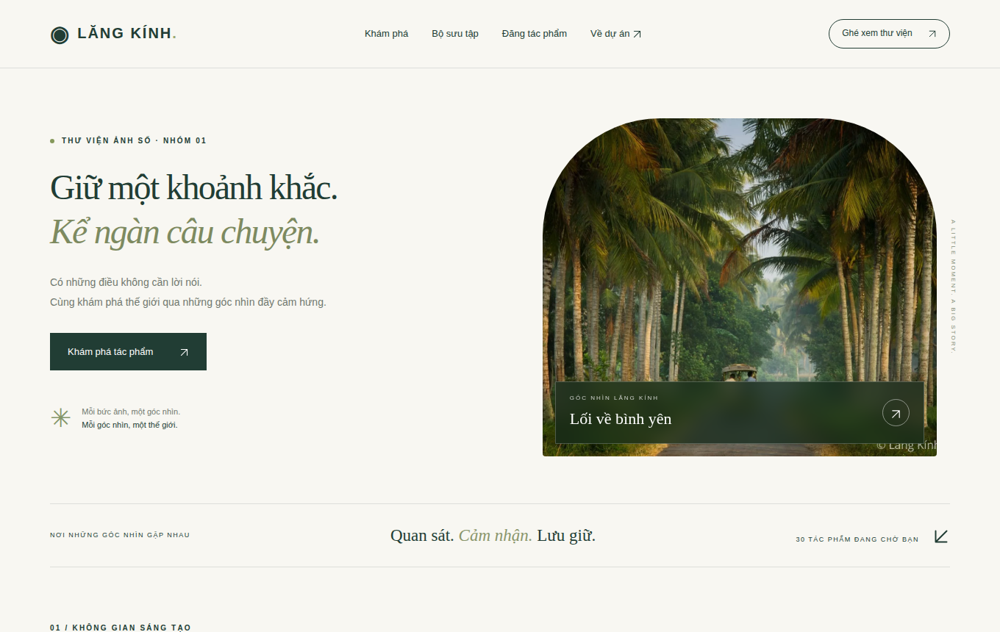

# Lăng Kính — Mẫu thư viện ảnh Nhóm 1

## Cài trong LocalWP

1. Xuất bản sao lưu website bằng LocalWP → chuột phải website → Export.
2. Start site → WP Admin → Giao diện (Appearance) → Giao diện → Thêm mới.
3. Tìm **Astra** của Brainstorm Force, cài đặt theme cha. Không xóa Astra sau khi cài child theme.
4. Thêm mới → Tải giao diện lên → chọn **lang-kinh-astra-child.zip** → Cài đặt → Kích hoạt.
5. Nếu website đã có thư mục `astra-child`, WordPress có thể hỏi thay thế phiên bản hiện tại: chỉ thay sau khi đã sao lưu phần tùy chỉnh cũ. ZIP này nâng cấp child theme cũ của nhóm.
6. Mở địa chỉ gốc của website, không phải một trang con. Mẫu dùng `front-page.php`, được WordPress tự chọn làm trang chủ, kể cả khi đang đặt trang chủ tĩnh. Không cần nhập database, Elementor hay plugin gallery.
7. Cài đặt → Đường dẫn tĩnh → Lưu thay đổi để cập nhật đường dẫn cho mục Tác phẩm. Cài đặt → Tổng quan → Ngôn ngữ trang web → Tiếng Việt nếu muốn.

## Có gì ngay khi kích hoạt?

- Banner, điều hướng, 30 ảnh mẫu, lưới ảnh, bộ sưu tập theo chủ đề, phần giới thiệu và footer.
- Bộ lọc chủ đề, lọc tác giả; tìm theo tên tác phẩm hoặc tác giả, hỗ trợ nhập không dấu.
- Lightbox: xem ảnh, ảnh trước/sau, phím mũi tên, Esc để đóng; giữ bàn phím trong hộp thoại bằng dialog của trình duyệt.
- Giao diện điện thoại, nút về đầu trang, lazy loading; ảnh thật dùng thêm srcset của WordPress.
- Không tải font, thư viện JS hay ảnh từ bên ngoài. Ảnh mẫu lấy từ `media-assets` của repo nhóm.
- Tên ảnh mẫu được đặt để minh họa. Không gán tác giả nhiếp ảnh giả; tất cả ghi “Bộ sưu tập mẫu”. Nhóm cần kiểm tra quyền sử dụng từng ảnh trước khi công bố.

## Thêm tác phẩm thật từ trang quản trị

1. **Tác phẩm → Chủ đề / Album**: tạo chủ đề như Phong cảnh, Chân dung, Đời sống. Một tác phẩm có thể thuộc nhiều chủ đề.
2. **Tác phẩm → Thêm mới**: nhập tên, thêm mô tả, chọn **Ảnh tác phẩm / Featured image**, chọn chủ đề, rồi Đăng.
3. Chọn **Tác giả** trong phần cài đặt bài viết. Nếu cần nhiều tác giả, quản trị viên tạo người dùng bằng Người dùng → Thêm mới và đặt tên hiển thị phù hợp. Đây là tác giả quản lý bài trong WordPress; chỉ dùng tên nhiếp ảnh gia khi đã xác nhận quyền ghi công.
4. Trang chủ hiển thị tác phẩm thật đã xuất bản có ảnh đại diện hợp lệ trước, sau đó giữ đủ 30 ảnh mẫu ghi “Bộ sưu tập mẫu”. Bài nháp, chờ duyệt, riêng tư và bài chưa có ảnh đại diện không được trưng bày. Một ảnh thật hợp lệ tương ứng tổng 31 ảnh; bộ lọc, tác giả, album, tìm kiếm và lightbox dùng chung danh sách kết hợp.
5. Ảnh đầu tiên trong lưới thư viện là tác phẩm được đăng gần đây nhất có ảnh đại diện; banner độc lập với lưới. Bộ sưu tập, số ảnh và danh sách tác giả tự lấy từ dữ liệu.
6. Điền văn bản thay thế cho ảnh trong Thư viện Media để hỗ trợ người dùng trình đọc màn hình.

Lưu ý: ảnh mẫu nằm trong theme để có giao diện ngay; chúng không tự nhập vào Media. Nên tải tác phẩm thật lên Media qua giao diện quản trị. Không cần sửa code để thay ảnh.

## Gửi tác phẩm từ frontend

- Child theme tạo trang **Đăng tác phẩm** tại `/dang-tac-pham/` khi được kích hoạt hoặc cập nhật lên 2.4.0 (ở lượt truy cập tiếp theo). Không tạo trùng trang đã có. Trang yêu cầu đăng nhập WordPress.
- Liên kết **Đăng tác phẩm** nằm trên menu trang chủ, kể cả điện thoại. Khách bấm đăng nhập sẽ quay về form.
- Quản trị viên tạo tài khoản cho người gửi tại **Người dùng → Thêm mới**, chọn vai trò **Tác giả (Author)**. Không bật đăng ký tài khoản công khai.
- Bản 2.4.0 bổ sung một lần các chủ đề đang dùng cho ảnh mẫu vào taxonomy thật, giữ nguyên chủ đề/tên đã có. Dropdown dùng chung taxonomy với tác phẩm thật: Đời sống, Chân dung, Phong cảnh, Thiên nhiên, Động vật, Tĩnh vật và các chủ đề người dùng đã tạo.
- Không chọn chủ đề sẽ lưu quan hệ **Tự do**. Chọn **Khác — tạo chủ đề mới**, nhập tên tối đa 80 ký tự; tên được lọc, tên có sẵn được dùng lại. Không cấp thêm quyền quản lý danh mục toàn WordPress cho Author. Chỉ tạo chủ đề sau khi lưu ảnh/bài thành công; bài vẫn pending. Không đổi chủ đề của bài cũ. Nếu lỗi, form giữ tên/mô tả/chủ đề đã nhập; cần chọn lại tệp ảnh.
- Form nhận JPG, PNG hoặc WebP, tối đa 12 MB; tiêu đề được lọc, có nonce chống CSRF và kiểm tra quyền `upload_files`/`edit_lk_photos`.
- Author được tạo/sửa tác phẩm của mình đang chờ duyệt, không có quyền xuất bản qua quản trị hoặc REST API. Administrator và Editor có quyền duyệt/xuất bản. Quyền bài viết thông thường không thay đổi.
- Ảnh được lưu trong Media Library, tạo bản ghi attachment và CPT `lk_photo` trong database WordPress, đặt làm ảnh đại diện và trạng thái **Chờ duyệt**. Quản trị viên duyệt trong **Tác phẩm** trước khi ảnh xuất hiện công khai.
- Form xử lý POST trong `template_redirect`, trước HTML; lưu thành công chuyển hướng HTTP 303 về GET. URL action không giữ tham số thông báo, gửi lần hai vẫn tạo bài và ảnh mới. Thông báo thành công phải có mã xác nhận theo người gửi và bài pending đã lưu có ảnh đại diện; chỉ gõ `?lk_upload=pending` không tạo thông báo thành công. Nếu lưu bài/gắn ảnh thất bại, dữ liệu vừa tạo được dọn dẹp.
- Nâng cấp chỉ tạo trang còn thiếu; không ghi đè nội dung/trạng thái trang cùng slug. Nếu trang cũ dùng slug này nhưng chưa có shortcode, tự thêm `[lk_upload_form]` vào trang mong muốn.
- Không cần tự tạo bảng SQL. WordPress lưu nội dung trong các bảng posts/postmeta/taxonomy hiện có. Xuất SQL chỉ khi cần bàn giao bản sao đã loại dữ liệu tài khoản/cấu hình nhạy cảm.
- Đăng nhập dùng màn hình WordPress mặc định; người gửi quay lại trang gửi ảnh sau khi đăng nhập.

## Watermark cho ảnh mẫu

30 ảnh mẫu hiển thị từ `assets/demo-watermarked/`, có chữ **© Lăng Kính · Nhóm 1** nhúng vào pixel ở góc dưới phải, trắng, opacity 65%, font Open Sans. Lightbox và URL ảnh đầy đủ cũng dùng bản này; không phải chữ phủ bằng CSS. Ảnh gốc ở `assets/demo/` được giữ nguyên. Khung thumbnail dùng crop theo thiết kế nên một phần watermark có thể nằm ngoài khung cắt; mở lightbox sẽ thấy ảnh đầy đủ.

Các bản đã tạo được đóng gói trong theme, không cần plugin chạy mỗi lần xem trang và không tạo attachment cho ảnh mẫu. File `manifest.json` ghi SHA-256 của từng bản gốc và bản đã đóng để kiểm tra. Không áp dụng watermark nhiều lần lên bản đã đóng.

Muốn tạo lại bản mẫu: bật Image Watermark trên WordPress dùng để build; đặt `LK_WP_ROOT` trỏ đến thư mục WordPress, chạy `php scripts/build-demo-watermarks.php` từ repo (dùng PHP CLI và socket MySQL của LocalWP nếu cần). Script sử dụng renderer của plugin, luôn đọc lại bản gốc, ghi qua file tạm rồi đổi tên. Nó không đổi thiết lập plugin, database hoặc ảnh Media. Sau đó copy `assets/demo-watermarked/` cùng code theme sang site. Không chỉnh plugin vendor.

Chữ watermark là nhận diện bộ sưu tập minh họa, không thay thế việc kiểm tra quyền sử dụng từng ảnh.

## Watermark upload và WebP

- **Image Watermark**: vào **Settings → Watermark**, bật `Automatic Watermarking`, `Front-end Watermarking` và `Manual Watermarking`; chọn `All uploads` vì form tải ảnh tạo attachment trước khi gắn vào tác phẩm. Chọn các kích thước `thumbnail`, `medium`, `large`, `full` và `lk-gallery`; bật backup ảnh gốc để có thể phục hồi. Dùng watermark chữ “© Lăng Kính · Nhóm 1” hoặc logo nhóm có quyền sử dụng; đặt ở góc dưới, opacity khoảng 55–65%. Chọn font **OpenSans-Regular.ttf** có đủ dấu tiếng Việt; font Lato đi kèm bản plugin đang cài thiếu chữ “ă”. LocalWP đã đổi riêng font watermark upload sang Open Sans, giữ các thiết lập khác. Đổi font chỉ ảnh hưởng lần đóng watermark tiếp theo, không tự xử lý lại ảnh cũ.
- **Converter for Media trên Nginx**: Nginx không đọc `.htaccess`. Với chế độ rewrite, làm theo [hướng dẫn Nginx của nhà phát triển](https://url.mattplugins.com/converter-error-rewrites-not-executed-instruction), áp dụng vào template cấu hình site LocalWP rồi restart site; không chỉ sửa file runtime vì LocalWP có thể tạo lại. Chỉ bật cả `uploads` và `themes` sau khi kiểm tra rewrite và ảnh fallback đúng.
- **Pass Thru**: trong bản plugin đã kiểm tra, `PassthruLoader::get_allowed_urls()` chỉ cho phép URL từ `uploads`, trong khi phần thay URL HTML có thể chọn cả `themes`. Vì vậy chọn output **WebP**, thư mục **uploads**; bỏ **themes** và **plugins**. Ảnh mẫu trong theme tiếp tục dùng JPG gốc hợp lệ. Chỉ chuyển JPG/PNG được hỗ trợ; không cần thêm WebP vào danh sách nguồn. Lưu cấu hình trong trang plugin để tạo lại `wp-content/webpc-passthru.php` bằng API của plugin, không sửa file vendor/loader bằng tay.
- Chạy bulk optimization sau khi sao lưu ảnh gốc; kiểm tra các kích thước `thumbnail`, `medium`, `large`, `lk-gallery`, `full` và ảnh tải mới. File WebP đầu ra nằm riêng trong `wp-content/uploads-webpc/`, không thay đuôi URL JPG trong theme. Xem [mô tả và hướng dẫn kiểm tra của plugin](https://wordpress.org/plugins/webp-converter-for-media/).
- Khi ảnh vỡ: dùng Network của trình duyệt ghi lại URL thực sự, mã HTTP, `Content-Type`, nội dung phản hồi, chuỗi redirect và `Accept`. So sánh JPG gốc, URL Pass Thru/rewrite, file WebP trên đĩa. HTTP 200 với body rỗng/HTML vẫn là ảnh lỗi. Thử một ảnh Media và một ảnh mẫu, cả `srcset` và lightbox; với rewrite kiểm tra thêm `Vary: Accept` và fallback trình duyệt không nhận WebP. Không kết luận thành công chỉ từ việc mở JPG gốc hoặc tắt plugin.
- LocalWP lúc kiểm tra đang tắt Converter for Media, lưu cấu hình `passthru` + `uploads,themes`; cấu hình Nginx chưa có rule chuyển WebP. Chưa bật lại Converter for Media hoặc sửa cấu hình Nginx trên site thật. Kiểm thử tái hiện plugin dùng site/database riêng; xem [báo cáo kiểm thử](../tests/README.md). Tắt plugin chỉ là khôi phục ảnh tạm thời; WebP toàn site (gồm ảnh mẫu trong theme) chưa hoàn tất cho đến khi cấu hình Nginx và kiểm tra thực tế đạt.
- Watermark ảnh cũ chỉ sau khi bật backup và thử trên một ảnh mẫu. Không tải logo watermark lên như ảnh tác phẩm.
- Xem phiên bản/license trong [PLUGIN-LICENSES.md](../PLUGIN-LICENSES.md). Cập nhật bảng nếu site cài phiên bản khác.

## Sửa giao diện

- `front-page.php`: nội dung banner, tên Lăng Kính, giới thiệu và cấu trúc trang chủ.
- `style.css`: màu sắc, chữ và bố cục. Các kiểu trang chủ giới hạn trong `.lk-home`.
- `functions.php`: đăng ký Tác phẩm/Chủ đề, nạp CSS/JS và đọc dữ liệu.
- `js/custom.js`: bộ lọc, tìm kiếm, lightbox, Back-to-top và trường chủ đề mới.
- Focus ô tìm kiếm nằm quanh toàn khung, không viền lệch bên trong input. Nút lightbox bỏ viền vuông và dùng focus bo tròn khi thao tác bàn phím. Chuyển ảnh ẩn ảnh cũ đến khi ảnh mới tải xong; ảnh lỗi có thông báo. Lưới giữ nhịp ảnh cao/thấp theo danh sách sau lọc.
- Từ 2.4.1, banner dùng một ảnh nhận diện cố định. Vào **Giao diện → Tùy biến → Lăng Kính — Ảnh banner**, chọn ảnh Media và chú thích tùy chọn rồi **Xuất bản**. Để trống chú thích thì lấy tên ảnh; alt lấy từ Media. Chưa chọn ảnh hoặc đã xóa ảnh thì dùng “Lối về bình yên” có watermark, chính là ảnh banner trước khi cập nhật trên LocalWP. Đăng/duyệt tác phẩm mới chỉ đổi thứ tự thư viện, không đổi banner. Không thay ảnh đại diện của tác phẩm.
- Những trang khác tiếp tục dùng template của Astra. Đây là trang chủ được viết bằng PHP, không phải mẫu Elementor.

## Phạm vi bài mẫu

Đã có giao diện, chủ đề/album, tác giả, lightbox, lazy loading, escape đầu ra trong template (`esc_html`, `esc_attr`, `esc_url`) và form upload chỉ dành cho tài khoản được phép. Ảnh mới được lưu ở trạng thái chờ duyệt.

Watermark dùng plugin; WebP vẫn tắt và chưa hoàn tất cấu hình Nginx. Phần 3 đã triển khai module bảo mật độc lập theme, Wordfence WAF Basic, LLAR 5 lần sai/15 phút, URL đăng nhập riêng bằng WPS Hide Login, chính sách mật khẩu và cấu hình Nginx bền vững. Đã chạy WPScan trước/sau và kiểm thử sau Stop/Start LocalWP thật; xem [hồ sơ ATTT và giới hạn xác minh](../docs/security/README.md). URL mới và hướng dẫn truy cập riêng được giữ ngoài Git; mật khẩu quản trị hiện có không đổi. WebP hiện đã được kiểm chứng trên LocalWP với rewrite Nginx; không dùng Pass Thru cho themes, xem README của repo. CSS trang login là CSS mẫu; không được nạp vào màn hình đăng nhập trong phiên bản này.

Không chứa database, mật khẩu hoặc `wp-config.php`. Việc kích hoạt theme không thay hoặc xóa nội dung WordPress hiện có. Khi đổi sang theme khác, Tác phẩm sẽ không hiện trong menu quản trị, nhưng vẫn được giữ trong database; kích hoạt lại child theme để truy cập.

## Giấy phép

Mã theme: GPL-2.0-or-later (tương thích Astra/WordPress). Theme cha Astra: GPL-2.0-or-later theo khai báo của theme; cần ghi phiên bản cài thực tế vào bảng kiểm kê. Quyền sử dụng các ảnh gốc cần kiểm tra riêng; giấy phép của mã không tự xác nhận bản quyền ảnh.

## Bổ sung kết quả WPScan API

Lần Docker WPScan 4.1.0 người dùng chạy ngày 27/10/2026 đã báo **API OK, Free, dùng 3 request, còn 19**. Agent đối chiếu log, che hostname và cập nhật [báo cáo bổ sung](../docs/security/WPSCAN-API-USER-RUN.md); không tự nhận đã thực thi lần Docker. Chế độ passive không nhận diện core/plugin nên chưa chứng minh độ phủ CVE cho toàn bộ thành phần. Không yêu cầu nhập lại token khi đã có API OK; không đưa giá trị token vào Git. Cập nhật này chỉ bổ sung tài liệu, giữ nguyên thiết kế, banner và tác phẩm.

## Bộ bàn giao

Xem [cài đặt/khôi phục](../docs/installation/README.md), [SQL demo và phạm vi ẩn danh](../database/README.md), [báo cáo LaTeX/PDF](../docs/report/README.md). SQL không chứa ảnh nhị phân hoặc mật khẩu mặc định; cần phục hồi media từ manifest và tạo admin mới. Không nhập SQL demo lên site thật có dữ liệu.

