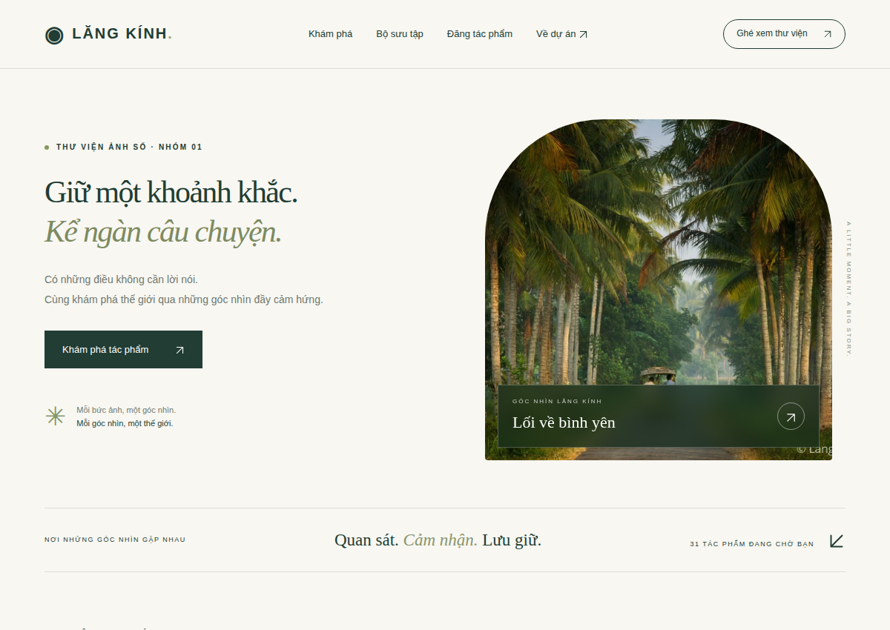

# Database demo bàn giao

`gallery-demo.sql` được xuất từ clone **database `local` của website LocalWP baitapnhom1**, không phải SQL tự dựng hoặc DB của site khác. Bản gốc được sao lưu ngoài repo trước thao tác; không làm sạch trên site chính.

## Các biến đổi chỉ thực hiện trên clone

- Chỉ giữ 12 bảng WordPress core; bỏ bảng log/cấu hình vendor, session, reset key, comment, link và các post type vận hành không cần demo.
- Ẩn danh người dùng, giữ ID tác giả để duy trì quan hệ. `user_pass=!HANDOVER_DISABLED!` là marker vô hiệu, không phải hash tài khoản thật. Không có mật khẩu mặc định để đăng nhập.
- Giữ bài gallery lưu trữ cần thiết, quan hệ thumbnail/topic, các trang demo và taxonomy. Đổi nội dung/tên mang tính riêng thành nhãn demo. Site nguồn không có lk_photo published tại thời điểm xuất; hai bài publish/pending được **bổ sung chỉ trên clone**, ghi rõ trong tiêu đề/nội dung.
- 9 attachment giữ ID nhưng thay file bằng ảnh mẫu watermark đã có trong repo, vì uploads nguồn có cả screenshot riêng/chưa rõ quyền. Metadata/kích thước ảnh được tạo lại đúng file thay thế. Không tuyên bố giữ nguyên ảnh upload thật.
- URL demo là `http://lang-kinh-demo.invalid`; URL/slug đăng nhập riêng, key Wordfence, watermark backup và cấu hình cấp phép không được xuất. Chỉ module riêng active; plugin vendor phải cài/cấu hình lại.
- Giữ role/capability phục vụ gallery; normalize theme mods trên clone để dùng banner mẫu cố định. Theme mods của site chính không bị đổi.

Script chuẩn bị có guard CLI, biến opt-in và DB clone đúng tên: [prepare-demo-clone.php](../scripts/prepare-demo-clone.php). **Không chạy script đó trên site thật**. Đây là công cụ chuẩn bị clone, không phải lệnh cài đặt thông thường.

## Khôi phục

Làm theo [hướng dẫn cài đặt đầy đủ](../docs/installation/README.md). Cài WordPress/Astra/child theme và module, tạo DB/config mới, import SQL vào DB trống, dùng WP-CLI search-replace hỗ trợ serialized data, phục hồi media, tạo admin mới bằng mật khẩu riêng.

SQL không chứa nhị phân ảnh. [media-manifest.json](media-manifest.json) ánh xạ ID attachment tới file ảnh trong repo và đường dẫn uploads tương đối. [restore-demo-media.php](../scripts/restore-demo-media.php) kiểm tra SHA-256, copy nguồn đã watermark và sinh các kích thước; chỉ chạy khi DB có marker demo. Không cần đưa uploads thật/iw-backup vào Git.

Quyền dùng ảnh mẫu chưa có hồ sơ xác nhận từng ảnh. Đây là giới hạn của tài sản hiện có, không được hợp thức hóa bằng GPL/MIT của code. Trước phát hành công khai, nhóm phải bổ sung nguồn/quyền hoặc thay bằng ảnh được phép, rồi tạo lại manifest/metadata/SQL trên clone.

## Kiểm chứng

[restore-verification.json](restore-verification.json) ghi kết quả lần import thật vào DB thứ hai với document root riêng, phục vụ bằng PHP development server trên loopback (không phải Nginx LocalWP chính), không copy uploads gốc. Kiểm tra serialized options, 9 attachment, taxonomy, 31 card (1 bài demo + 30 mẫu) và đăng nhập HTTP sau bootstrap admin mới. Đây là bằng chứng **restore riêng**, không phải cấu hình bảo mật LocalWP chính.

Không commit SQL gốc/backup thật, thông tin kết nối, wp-config hoặc credentials của tài khoản bootstrap thử.