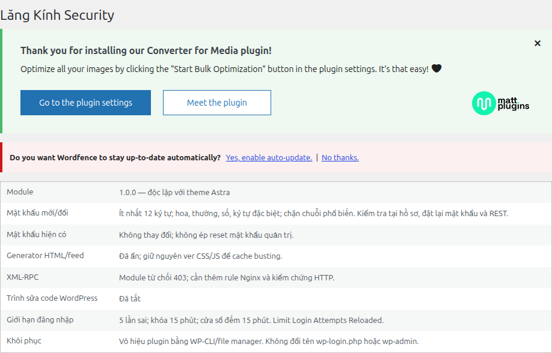
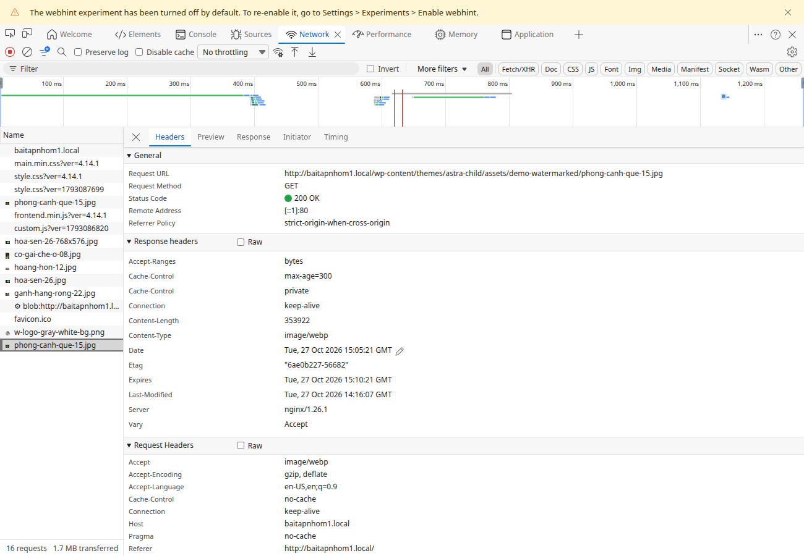

# Phần 3 — ATTT và bảo mật hệ thống Lăng Kính

Ngày thực hiện: **27/10/2026**, trên Ubuntu/LocalWP thật. Nhánh `huyyhoangg`, commit nền `87a81af`; working tree sạch khi bắt đầu. Đã đối chiếu đầu nhánh GitHub cùng commit, không reset/push/merge. Site `http://baitapnhom1.local`, ID LocalWP `BE0gvBpyy`, document root `$HOME/Local Sites/baitapnhom1/app/public`.

Đây là hồ sơ cấu hình và kiểm chứng, **không phải chứng nhận không còn lỗ hổng**. Không dùng môi trường WordPress riêng làm bằng chứng cho các kết quả dưới đây. Những kiểm thử gallery trước đây ở `tests/README.md` là lịch sử riêng; đợt này dùng tài khoản và ảnh thử trên chính LocalWP rồi dọn sạch.

## Bổ sung API token đã chạy thành công

Người dùng đã chạy WPScan 4.1.0 bằng Docker trên LocalWP và cung cấp log: **API OK, Free, dùng 3 request, còn 19**. Đã đối chiếu file log và che hostname; xem [báo cáo bổ sung](WPSCAN-API-USER-RUN.md). Không trộn với các lần agent chạy 3.8.28 không có token. Phạm vi CVE vẫn chưa đầy đủ do passive không nhận diện core/plugin; không kết luận website không có lỗ hổng.

## Cấu hình thực tế

- WordPress 7.1.3; Astra 4.14.1, child theme 2.4.1; PHP 8.2.29, Nginx 1.26.1, MySQL 8.4.0 của LocalWP.
- Wordfence 9.0.2 đang hoạt động, có key và không còn cờ yêu cầu hoàn tất đăng ký. Key không lưu trong repo. Wordfence xuất hiện/được bật trong lúc thực hiện; đã đối chiếu file với gói chính thức và bảo toàn việc cài này. WAF đã chuyển sang **enabled/basic** bằng API cấu hình của plugin. Không cấu hình auto-prepend/Extended Protection và không tuyên bố đã chạy quét malware Wordfence.
- Wordfence mặc định bỏ qua dải IP private/loopback. Vì vậy dùng **Limit Login Attempts Reloaded 3.3.10** cho khóa đăng nhập trên LocalWP: 5 lần sai, khóa 15 phút, cửa sổ đếm 15 phút, khóa dài 1 giờ sau 4 đợt. Dùng app Local miễn phí, không đăng ký dịch vụ cloud, chỉ tin `REMOTE_ADDR`. Không tin header IP tùy ý của client.
- Để không chạy trùng, `loginSecurityEnabled` và kiểm tra mật khẩu mạnh tương ứng của Wordfence được tắt. Chính sách mật khẩu do module riêng đảm nhiệm. Không tắt REST hoặc application-password availability của WordPress. Wordfence Security Network sharing được tắt trong cấu hình local.
- **WPS Hide Login 1.9.19** đang hoạt động. URL mới sinh ngẫu nhiên và chỉ ghi trong hồ sơ riêng ngoài Git. URL cũ/`wp-admin` với khách được xử lý 404; không đổi tên file/thư mục core. URL bị giấu chỉ giảm nhiễu, không thay thế phân quyền/khóa đăng nhập.
- **Lăng Kính Security 1.0.0** là plugin riêng ở `security/lang-kinh-security/`, độc lập với theme. Ẩn generator HTML/feed, chặn XML-RPC dự phòng, tắt trình sửa code trong admin, thêm header cơ bản; kiểm tra mật khẩu tại hồ sơ, đặt lại và REST.
- Mật khẩu mới/đổi: ít nhất 12 ký tự, có hoa/thường/số/ký tự đặc biệt, chặn chuỗi phổ biến. Không kiểm tra lại hoặc đổi mật khẩu quản trị hiện có; không ép reset. Đây là chính sách tối thiểu được kiểm thử, không phải dịch vụ kiểm tra mật khẩu rò rỉ.
- Nginx: `autoindex off`, chặn XML-RPC, readme/config và các wizard install/setup không dùng trên site đã cài. PHP: tắt hiển thị lỗi và `expose_php`, vẫn ghi log. Không sửa `.htaccess` để thay cho Nginx.
- Trạng thái lịch sử lúc hardening: Converter tắt. Đợt sửa WebP sau đó đã bật lại theo rewrite Nginx, kiểm tra Accept/MIME/fallback và watermark trên LocalWP thật; xem [hướng dẫn hiện tại](../../docs/installation/README.md). Image Watermark giữ hoạt động. Không sửa core hoặc vendor. Chỉ chỉnh quyền truy cập của file ứng dụng theo yêu cầu.

## Bằng chứng và tài liệu

- [Checklist](CHECKLIST.md): trạng thái từng yêu cầu và đường dẫn bằng chứng.
- [Cấu hình và khôi phục](CONFIGURATION-RECOVERY.md): triển khai, rollback, lấy URL riêng, mở khóa.
- [Quét và đánh giá](SCAN-AND-ASSESSMENT.md): các lần quét trước và đánh giá cấu hình. [WPScan có API do người dùng chạy](WPSCAN-API-USER-RUN.md): kết quả bổ sung mới, nguồn bằng chứng và giới hạn độ phủ.
- [HTTP trước](evidence/http-before.json), [HTTP sau](evidence/http-after.json).
- [Stop/Start LocalWP](evidence/localwp-restart.json), [quyền ứng dụng](evidence/permissions.json), [đối chiếu mã gốc](evidence/source-integrity.json), [trạng thái plugin](evidence/plugin-status.json).
- [Lần WAF chặn scanner](evidence/wpscan-waf-blocked.json), [WPScan trước](evidence/wpscan-before.json), [WPScan sau](evidence/wpscan-after.json): bản tóm tắt allowlist, không phải raw.
- [Kiểm thử hồi quy LocalWP](evidence/regression-localwp.json), [bảo toàn dữ liệu sau dọn fixture](evidence/preservation.json), [kiểm tra log cuối](evidence/final-verification.json).
- [Cấu hình module](evidence/hardening-settings.png), [khóa đăng nhập thực tế](evidence/login-lockout.png), [gallery sau hardening](evidence/gallery-after.png). Ảnh khóa đã làm mờ trường username thử; ảnh WPS đã che hoàn toàn trường slug bằng vùng đậm; không có thanh địa chỉ, token, cookie, password hoặc URL đăng nhập mới. Có thêm [cấu hình URL đã che](evidence/wps-login-redacted.png) và [redirect mặc định](evidence/wps-redirect.png).

Sao lưu site, SQL, cấu hình LocalWP và raw scan nằm ở thư mục riêng mode 700 dưới `$HOME/.local/share/lang-kinh-security/`; file chứa dữ liệu nhạy cảm mode 600. Có bản bổ sung sau khi Wordfence được đăng ký để giữ cấu hình mới. Không đưa các bản này vào Git. Tên/URL đăng nhập và hướng dẫn truy cập thật chỉ có trong hồ sơ riêng, không trong tài liệu công khai này.

## Bàn giao hiện tại và hình minh chứng

Inventory JSON cũ là ảnh chụp lịch sử, không được sửa thành lần kiểm tra mới. Xem [báo cáo học phần](../report/README.md), [hồi quy LocalWP mới](../report/verification-localwp.json) và [restore riêng](../../database/restore-verification.json). Sanitizer hiện có test che toàn bộ Authorization/Bearer/Basic và Cookie, không chỉ tên scheme.

